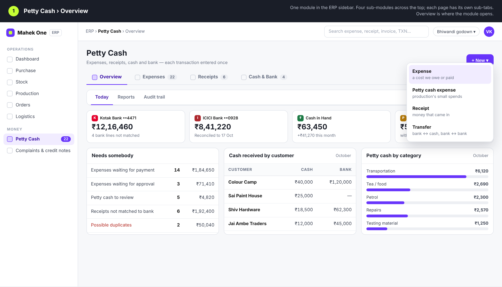
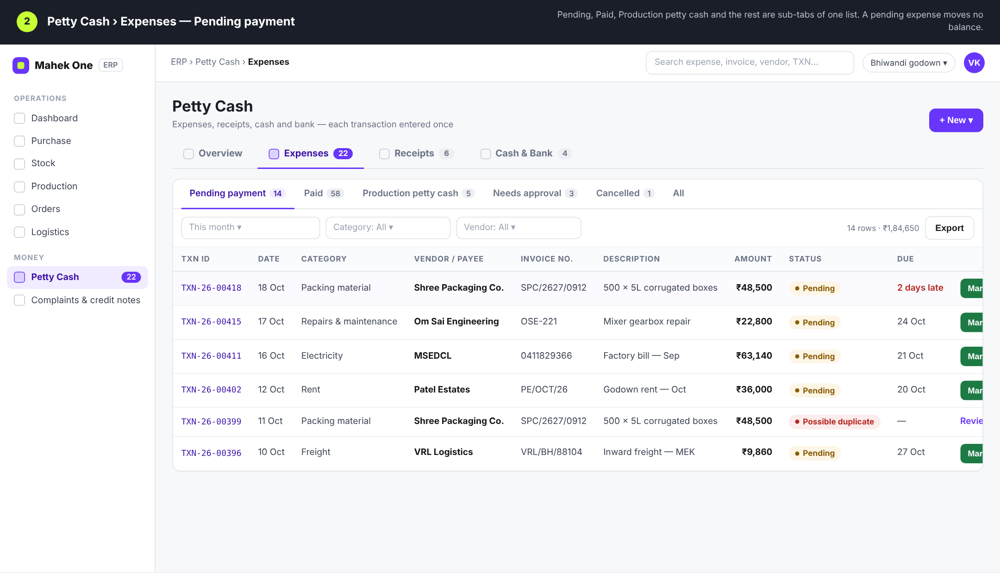
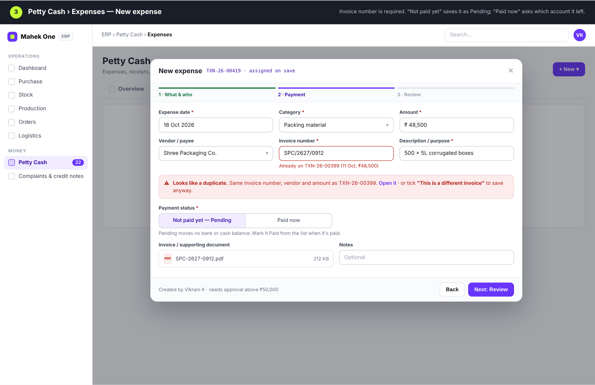
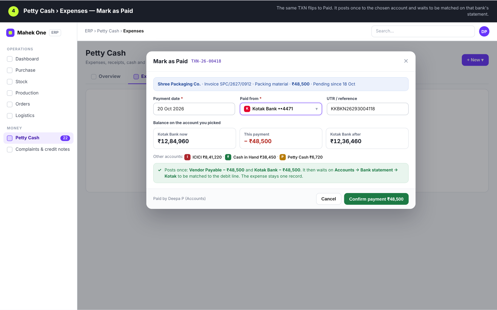
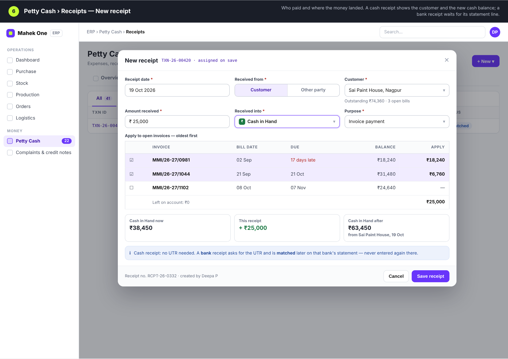
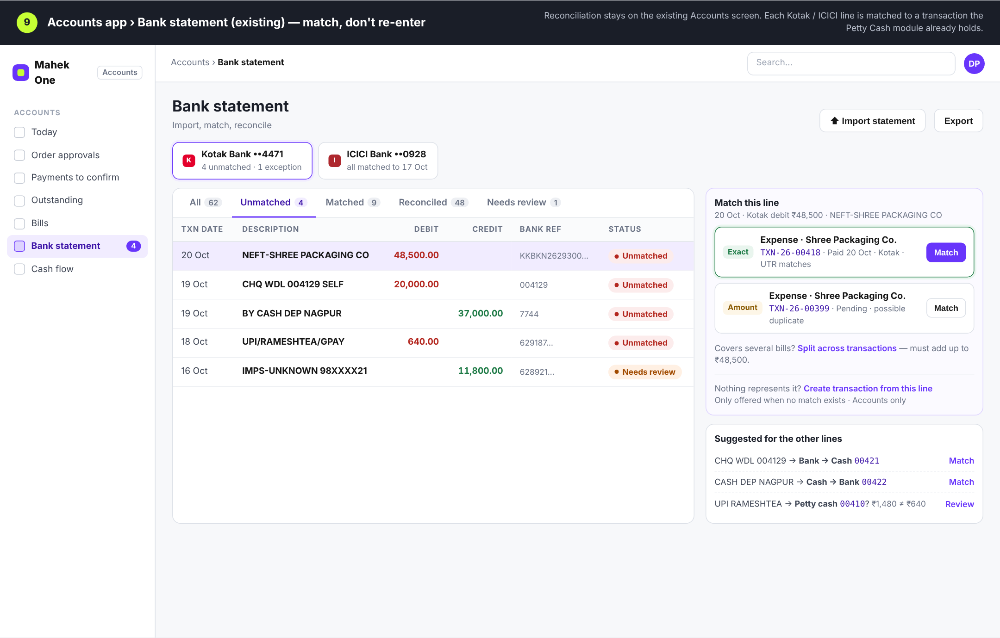

# ERP Petty Cash module — UI mockups

Mockups for the Expense / Receive / Cash & Bank / Petty Cash / Bank Statement
workflow (spec v1.0, 20 Oct 2026). Nothing here is built yet, and these replace
every earlier petty-cash design.

## Structure

Petty Cash is **one** entry in the ERP sidebar. Inside it, four sub-modules
across the top, and each page keeps its lists as sub-tabs:

| Sub-module | Sub-tabs |
|---|---|
| Overview (opens here) | Today · Reports · Audit trail |
| Expenses | Pending payment · Paid · Production petty cash · Needs approval · Cancelled · All |
| Receipts | All · Bank · Cash · Not matched to bank |
| Cash & Bank | Transfers · Kotak · ICICI · Cash · Petty Cash (account statements) |

Reconciliation stays on the existing **Accounts → Bank statement** screen; no
second bank statement screen is built.

## The rule

One real movement of money is entered once, gets one Transaction ID, and posts
to the ledgers once. A pending expense moves no balance. Transfers between our
own accounts are never income or expense. Bank lines are matched, not re-entered.

## Screens

| # | Screen | Image |
|---|---|---|
| 1 | Overview › Today |  |
| 2 | Expenses › Pending payment |  |
| 3 | Expenses › New expense |  |
| 4 | Expenses › Mark as Paid |  |
| 5 | Expenses › Production petty cash |  |
| 6 | Receipts › New receipt |  |
| 7 | Cash & Bank › Transfers |  |
| 8 | Cash & Bank › Cash statement |  |
| 9 | Accounts › Bank statement (existing) |  |

`mockup.html` is the source. Names, amounts and IDs are placeholders.
