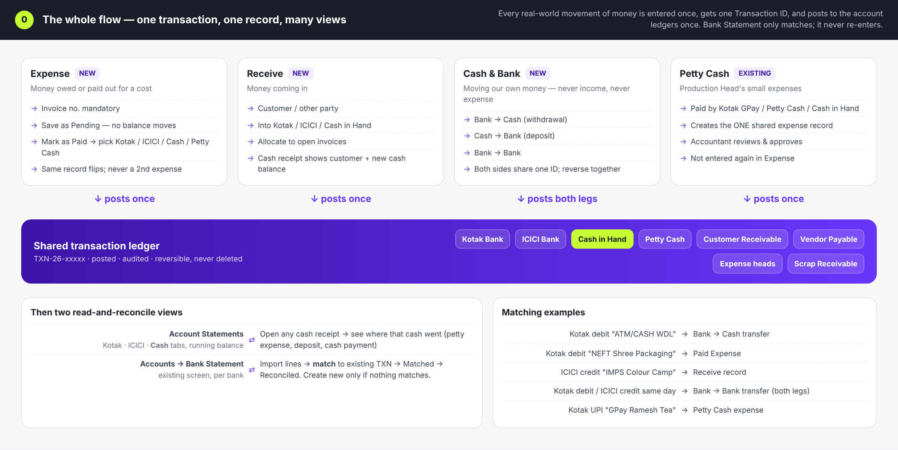
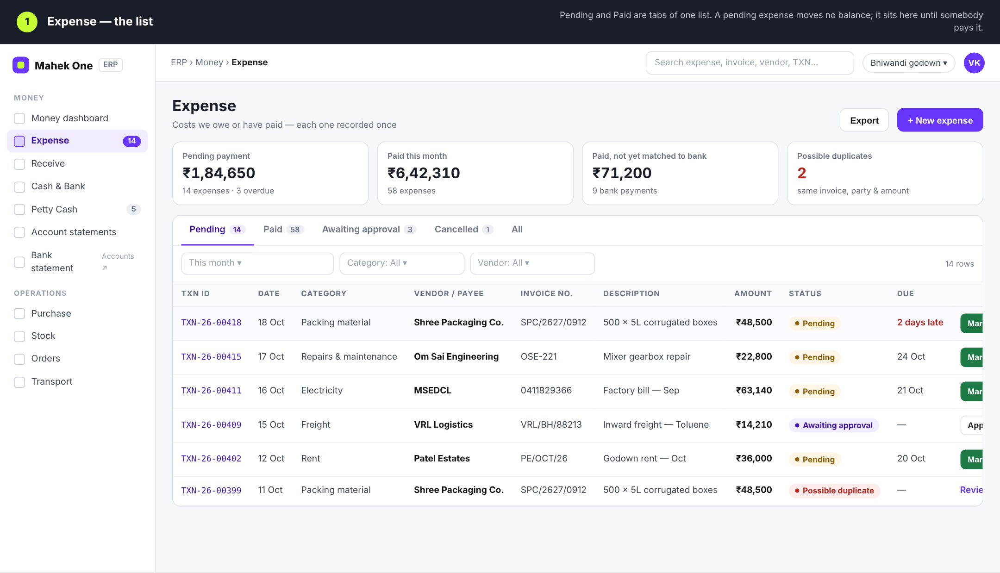
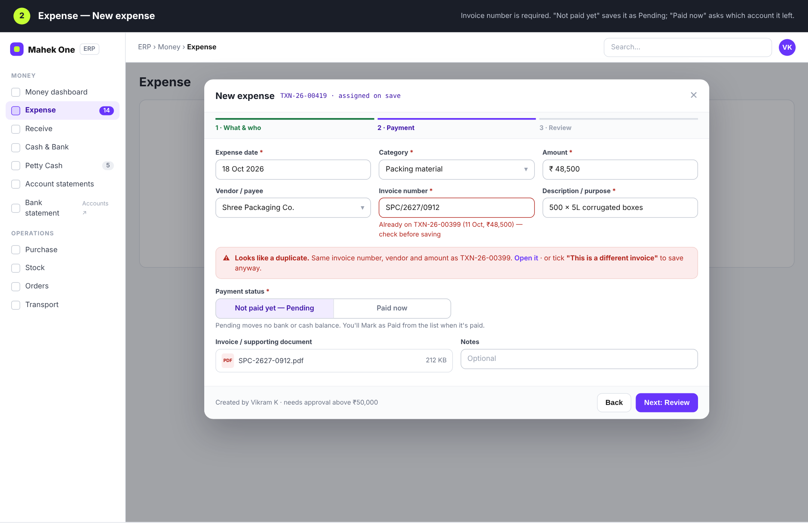
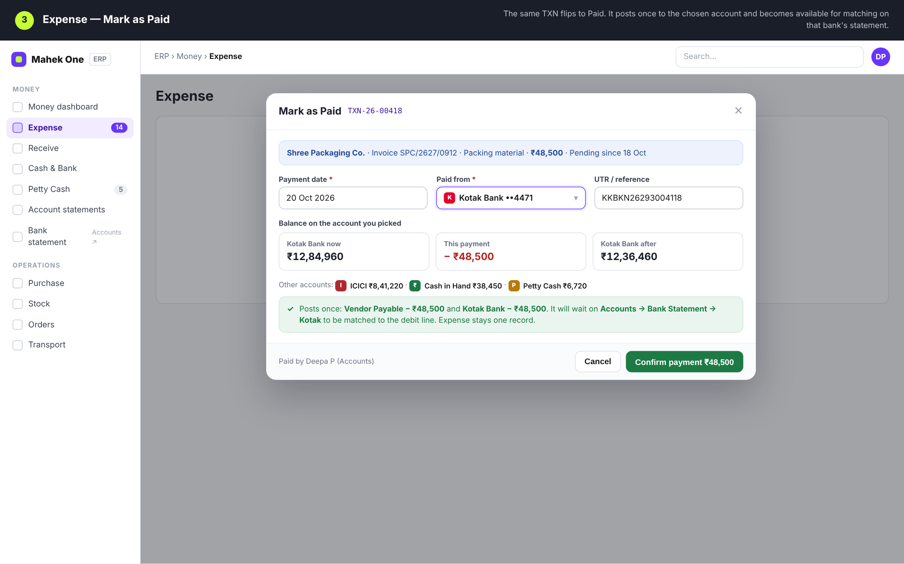
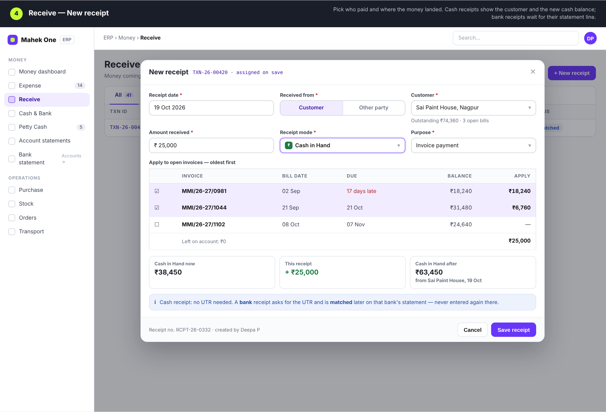
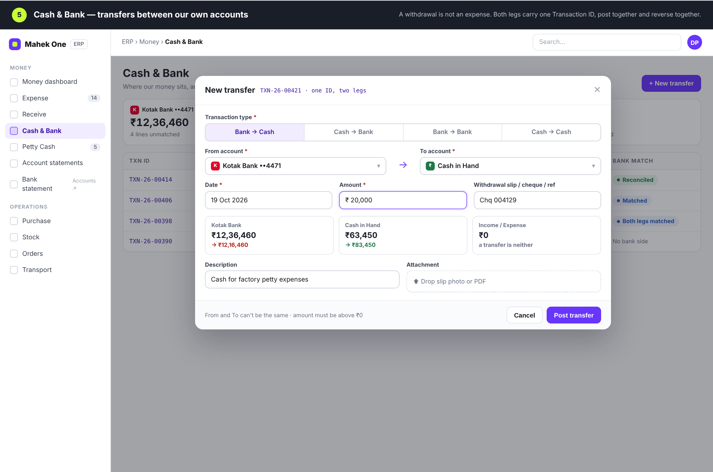
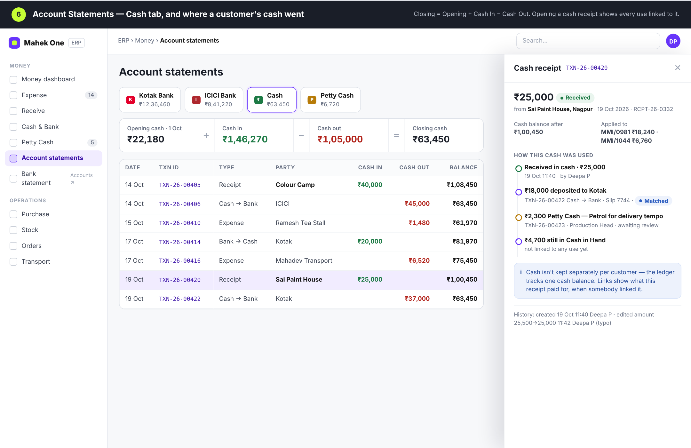
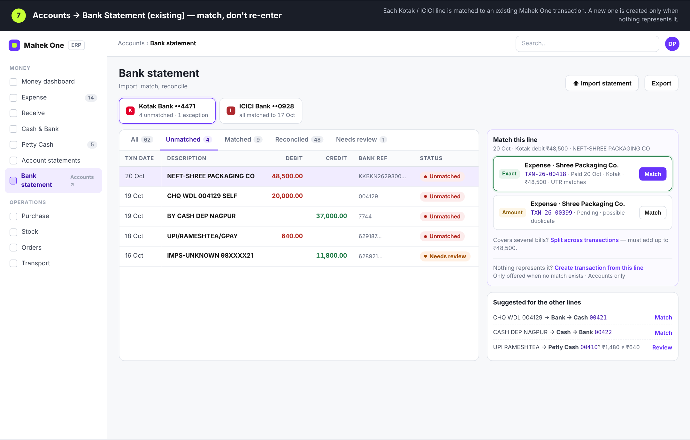
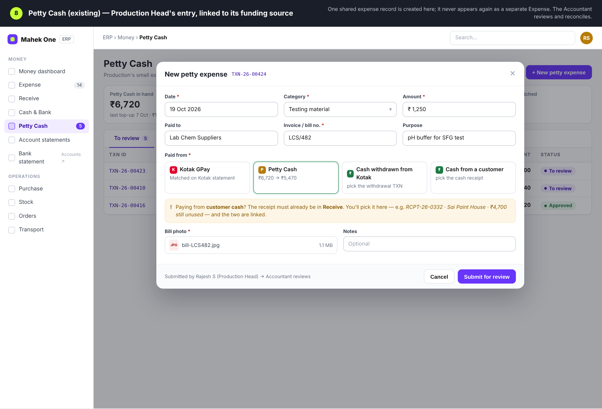
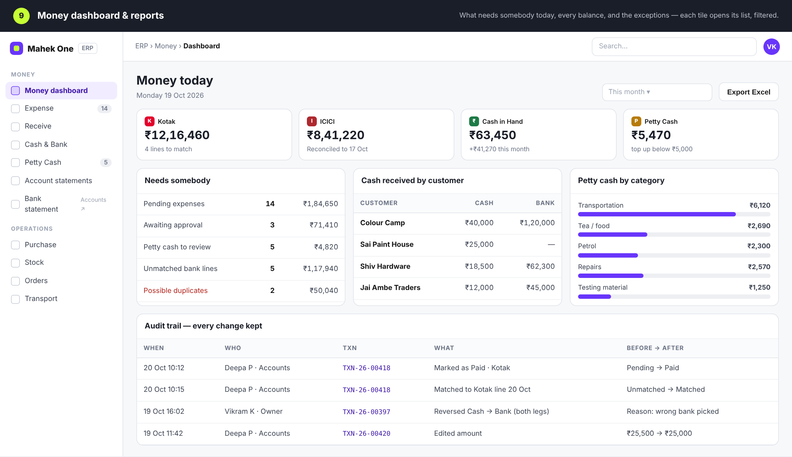

# ERP money flow — UI mockups

Screens for the Expense / Receive / Cash & Bank / Petty Cash / Bank Statement
workflow (spec v1.0, 20 Oct 2026). These are mockups only — nothing here is
built yet, and they replace every earlier petty-cash design.

The rule the screens follow: one real-world movement of money is entered once,
gets one Transaction ID, and posts to the ledgers once. Bank Statement only
matches existing transactions.

| # | Screen | Image |
|---|---|---|
| 0 | The whole flow |  |
| 1 | Expense — list (Pending / Paid) |  |
| 2 | Expense — new, with duplicate warning |  |
| 3 | Expense — Mark as Paid |  |
| 4 | Receive — new receipt, applied to invoices |  |
| 5 | Cash & Bank — transfer |  |
| 6 | Account statements — Cash tab and where a receipt's cash went |  |
| 7 | Accounts → Bank statement — matching |  |
| 8 | Petty Cash — entry linked to its funding source |  |
| 9 | Money dashboard, reports, audit trail |  |

`mockup.html` is the source; open it in a browser to see all screens at once.
Names, amounts and IDs are placeholders.
