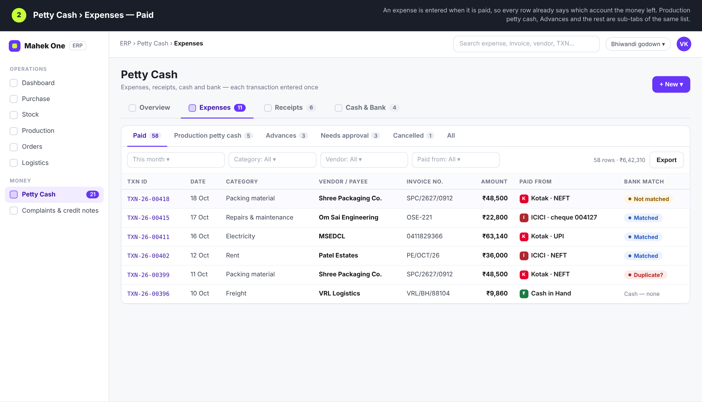
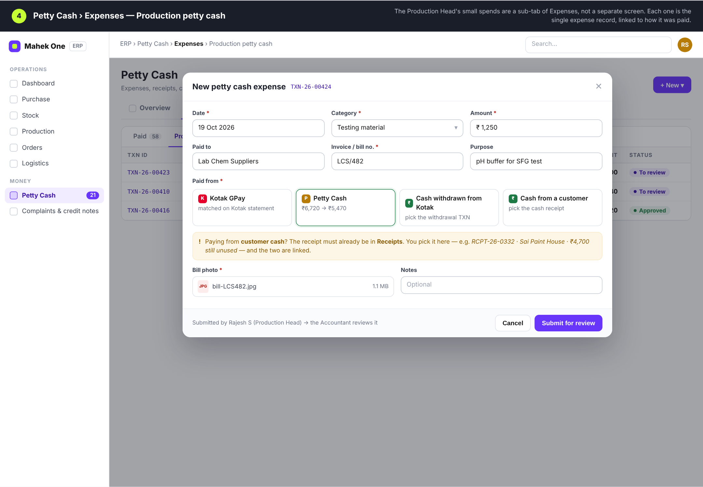
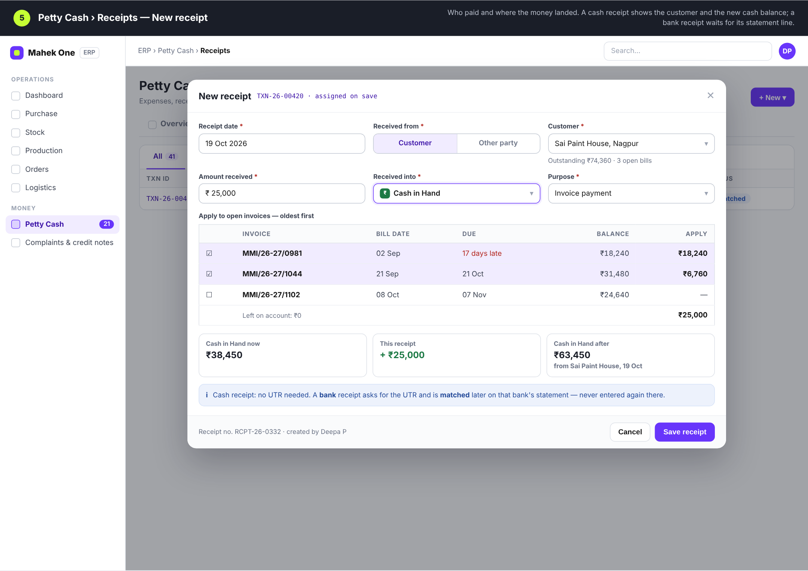
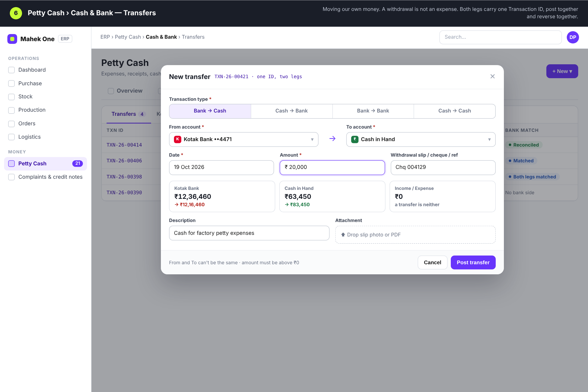
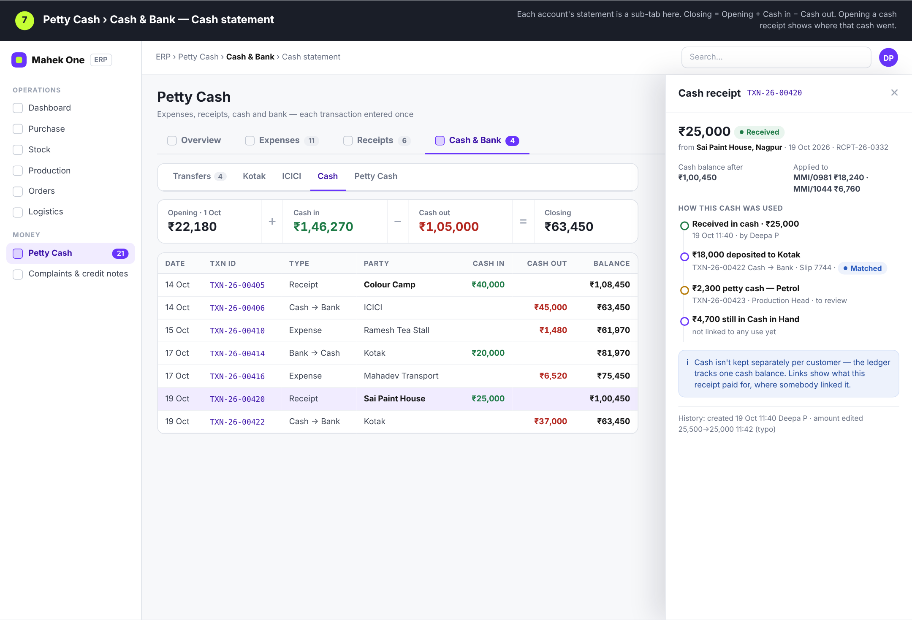
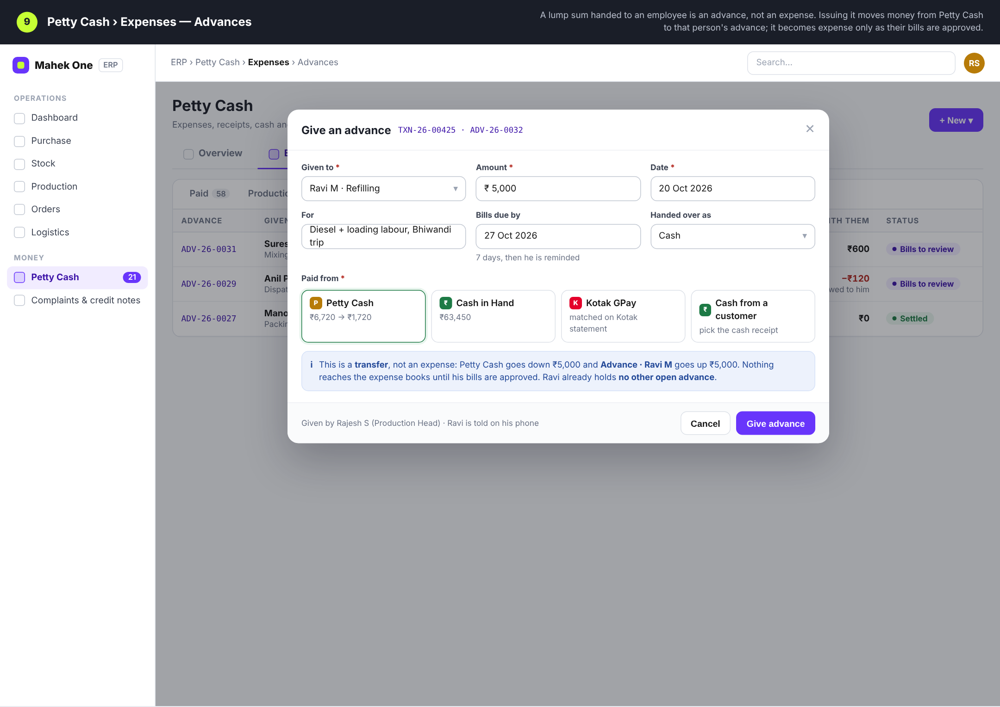
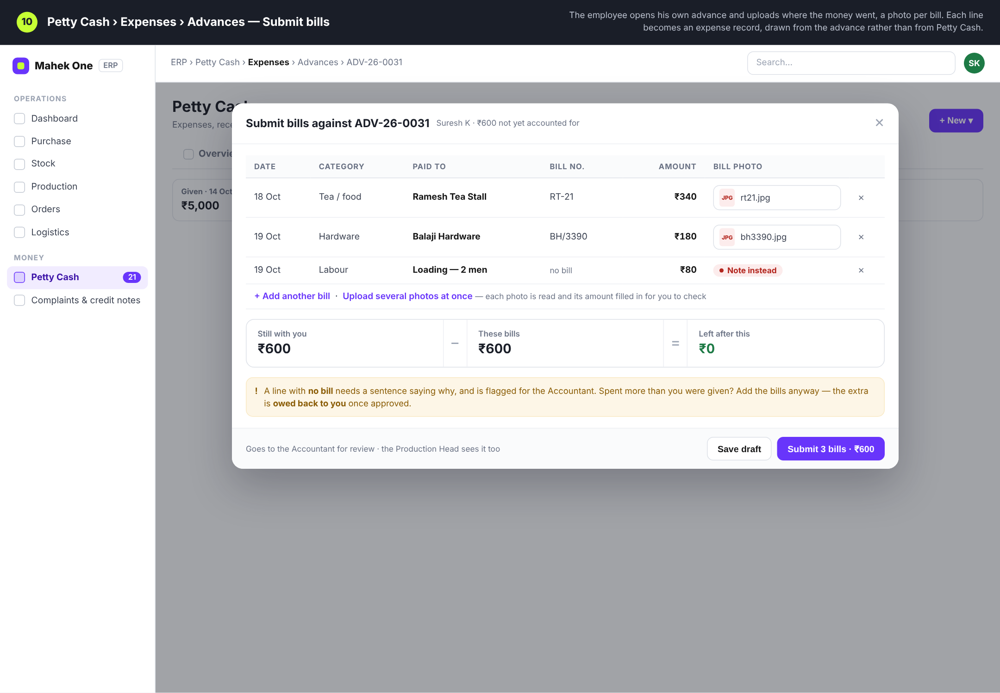
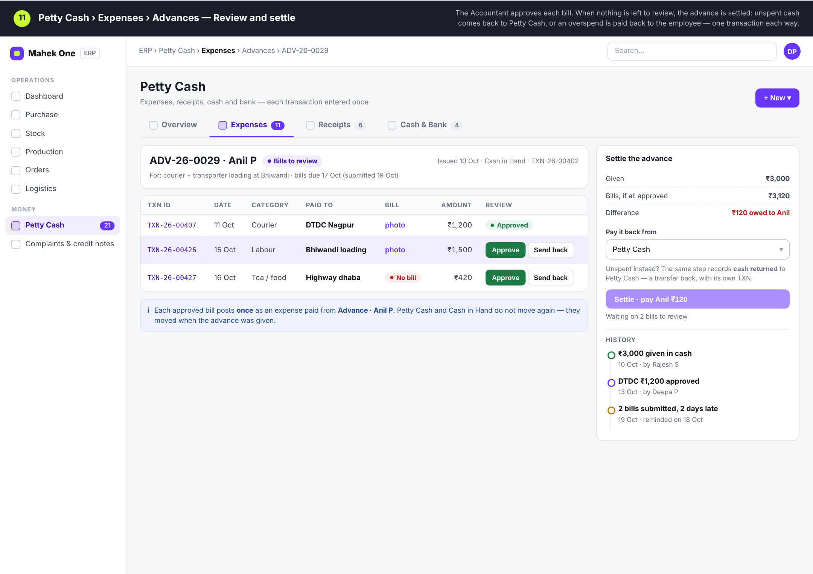

# ERP Petty Cash module — UI mockups

Mockups for the Expense / Receive / Cash & Bank / Petty Cash / Bank Statement
workflow (spec v1.0, 20 Oct 2026). Nothing here is built yet, and these replace
every earlier petty-cash design.

## Structure

Petty Cash is **one** entry in the ERP sidebar. Inside it, four sub-modules
across the top, and each page keeps its lists as sub-tabs:

| Sub-module | Sub-tabs |
|---|---|
| Overview (opens here) | Today · Reports · Audit trail |
| Expenses | Paid · Production petty cash · Advances · Needs approval · Cancelled · All |
| Receipts | All · Bank · Cash · Not matched to bank |
| Cash & Bank | Transfers · Kotak · ICICI · Cash · Petty Cash (account statements) |

Reconciliation stays on the existing **Accounts → Bank statement** screen; no
second bank statement screen is built.

## The rule

One real movement of money is entered once, gets one Transaction ID, and posts
to the ledgers once. An expense is entered when it is paid, so there is no
"not paid" or pending state: every expense names the account the money left. Transfers between our
own accounts are never income or expense. Bank lines are matched, not re-entered.

## Advances to employees

A lump sum handed to an employee (say ₹5,000 from the Production Head) is an
**advance**, not an expense. Giving it is a transfer: Petty Cash (or Cash in
Hand, or Kotak) goes down and *Advance · that employee* goes up. The employee
then submits his bills against the advance, a photo each; every approved bill
posts once as an expense paid from his advance, so Petty Cash does not move a
second time. When nothing is left to review the advance is settled in one step:
unspent cash returned to Petty Cash, or an overspend paid back to him. A bill
with no receipt needs a written reason and is flagged for the Accountant.

## Screens

| # | Screen | Image |
|---|---|---|
| 1 | Overview › Today |  |
| 2 | Expenses › Paid |  |
| 3 | Expenses › New expense |  |
| 4 | Expenses › Production petty cash |  |
| 5 | Receipts › New receipt |  |
| 6 | Cash & Bank › Transfers |  |
| 7 | Cash & Bank › Cash statement |  |
| 8 | Accounts › Bank statement (existing) |  |
| 9 | Expenses › Advances › Give an advance |  |
| 10 | Advances › Employee submits bills |  |
| 11 | Advances › Review and settle |  |

`mockup.html` is the source. Names, amounts and IDs are placeholders.
